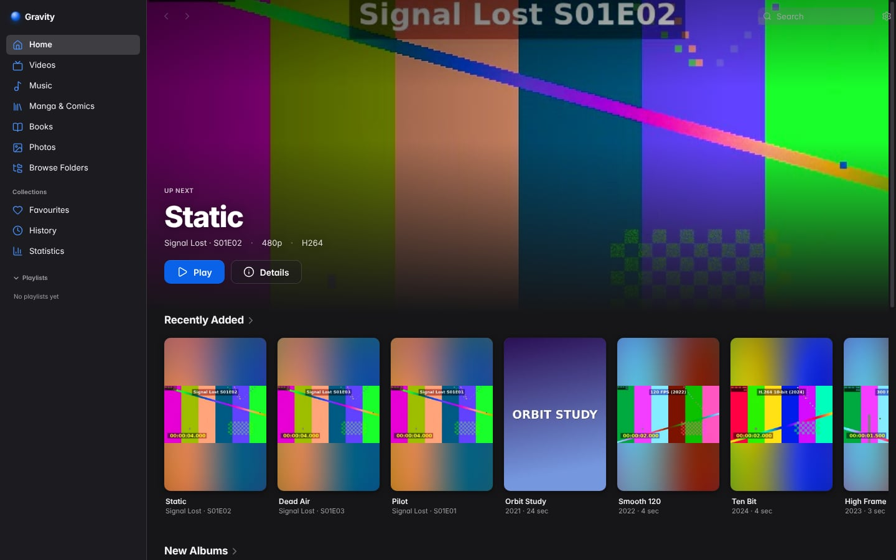
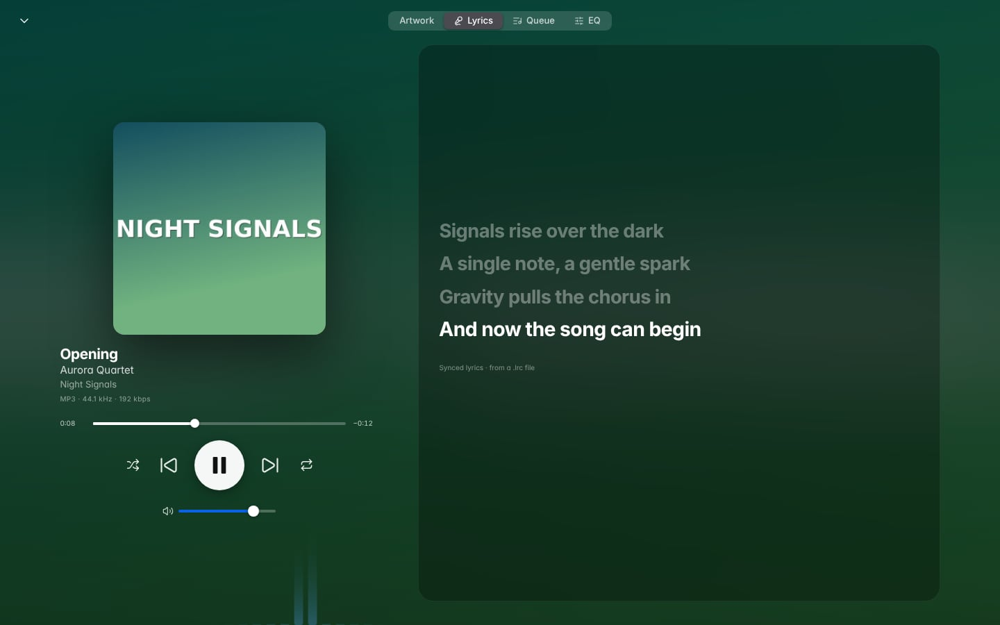
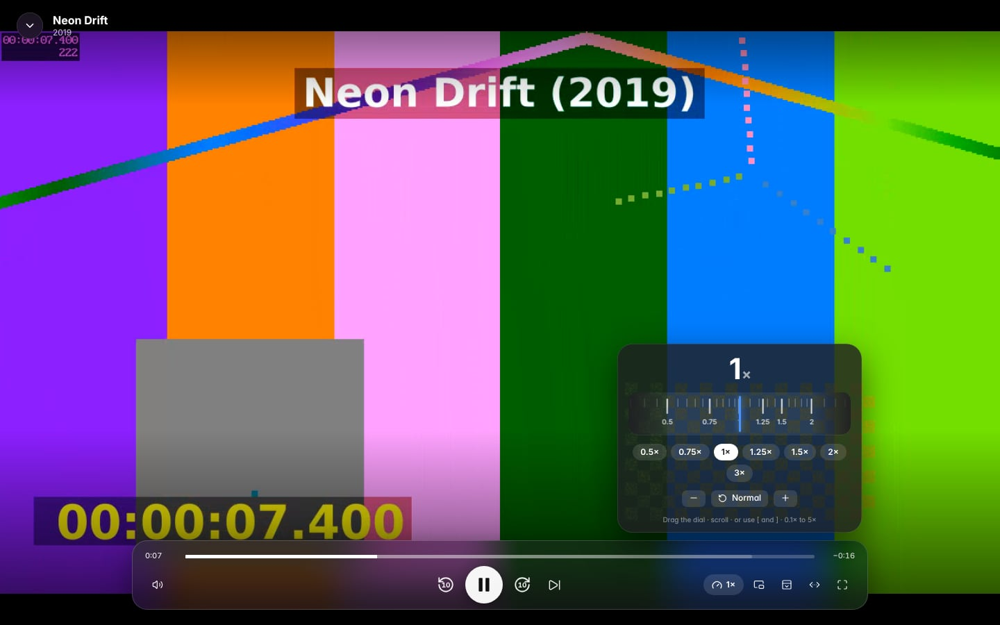
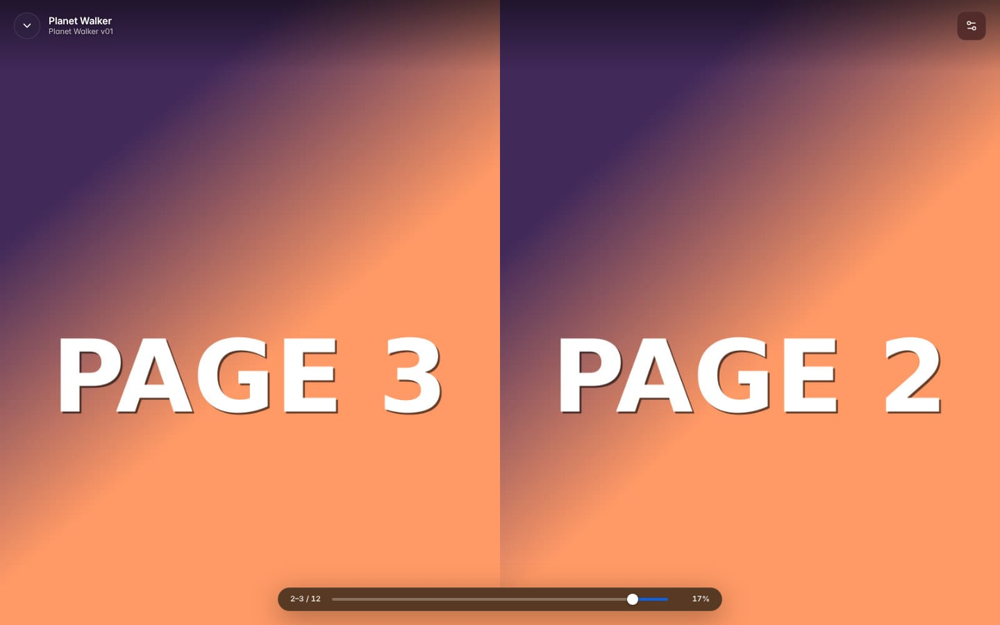

# Gravity

A local-first media player and library for **video, music, manga/comics, books and photos**.

Gravity borrows Jellyfin's library thinking (point it at folders, it works out the rest), Apple TV's calm,
artwork-first browsing, and Apple Music's listening experience — and runs entirely on your computer. There is no
server to set up, no account, no cloud and no telemetry.

<p align="center">
  
  
</p>
<p align="center">
  
  
</p>

> The screenshots use generated test-pattern media (`npm run sample-media`), not real artwork.

## What it does

| | |
|---|---|
| **Library** | Add folders; Gravity reads them in place. File-explorer style *Browse*, plus Movies, Shows, Albums, Artists, Songs, Manga, Books and Photos views with artwork, metadata, filters, sorting, search, favourites, ratings, notes and playlists. Posters, covers, `.nfo` files, embedded tags and `.lrc` lyrics are picked up automatically. New, renamed and deleted files show up on their own — and a rename keeps your favourites and progress. |
| **Video** | Direct play whenever the system can, lossless re-wrap (remux) when only the container is the problem, real-time conversion as a last resort — never a converted copy on disk. Audio tracks, subtitles (SRT/VTT/ASS, drawn by the player so size, colour and delay are yours), chapters, **speed from 0.1× to 5×** with a draggable speed dial, seek-bar thumbnails, frame stepping, ±N-second skips, Picture-in-Picture, a **mini player**, an always-on-top **overlay** (aspect-locked, adjustable opacity, optional click-through), full screen, screenshots, a playback-stats overlay, and per-title resume. |
| **History & statistics** | Continue Watching / Continue Reading, Recently Played, completed titles, per-title progress, ratings and notes, and a Statistics page: hours in total and per day, time of day and weekday rhythm, most-watched titles and shows, top tracks, artists and genres, streaks, average speed — all computed locally. |
| **Music** | An Apple-Music-style player: Now Playing with artwork-tinted background, synced lyrics, queue (drag to reorder), shuffle, repeat, gapless playback and crossfade, ReplayGain, a **10-band equaliser** with preamp, limiter, presets and a live response curve, night mode, balance, output-device selection, mini player, listening history, and Media Session controls (keyboard media keys, OS now-playing). |
| **Manga, comics, books, photos** | A comic reader (CBZ and folders of images) with single, two-page and continuous-scroll layouts, left-to-right or right-to-left, fit modes, zoom/pan, preloading and next-volume navigation; an EPUB reader with pagination or scrolling, themes, fonts, margins, contents, in-book search and progress; a photo and GIF viewer with filmstrip, zoom, rotation and slideshow. Progress is saved for every book. |
| **Customisation** | Themes (Automatic, Light, Dark, Midnight, Paper, High Contrast), eight contrast-checked accent colours, text size, density, artwork size, sidebar order and visibility, Home shelves, which buttons appear in the video and music players (and in what order), and **every keyboard shortcut is rebindable** with conflict detection. Reduce motion and reduce transparency are honoured. |
| **Built for big libraries and slow disks** | Quick scans compare folder timestamps, directories are read in sorted order, concurrency drops to one on hard drives, file-system *events* replace polling, artwork and seek previews are generated lazily and cached, and nothing is written next to your media. A drive that is unplugged is kept, not forgotten. |

### Formats

Gravity plays what the Chromium media stack supports directly and uses **ffmpeg** (a separate program, found on your
`PATH`, in Settings, or bundled with the installer) for everything else.

| Kind | Handled directly | Via ffmpeg (remux or real-time conversion) |
|---|---|---|
| Video | MP4, M4V, MOV, WebM, MKV, OGV, 3GP with H.264 / VP8 / VP9 / AV1 (and HEVC where the OS can decode it) | AVI, WMV, FLV, MPEG/TS/M2TS/VOB, RealMedia, DivX, MXF, HEVC without OS support, AC-3/E-AC-3/DTS/TrueHD audio, 10-bit and HDR (tone-mapped), bitmap subtitles (PGS/VobSub, burned in) |
| Audio | MP3, AAC, M4A, FLAC, WAV, Ogg Vorbis, Opus, MKA | ALAC, APE, WavPack, WMA, AIFF, DSD, TTA, Musepack, AMR, MP2 |
| Images | JPEG, PNG, GIF (animated), WebP, AVIF, BMP, SVG, ICO, APNG | TIFF falls back to a converted preview |
| Comics | CBZ, folders of images | — (CBR/CB7 are not supported, see [limitations](docs/LIMITATIONS.md)) |
| Books | EPUB 2 and 3 | — (see [limitations](docs/LIMITATIONS.md)) |

Subtitles: SRT, WebVTT, ASS/SSA (sidecar files and embedded tracks). Lyrics: `.lrc` and embedded tags.

### High frame rates and high-refresh displays

Gravity never lowers the frame rate of a file: 60, 120 and 300 fps clips are decoded and presented at their own rate
when your hardware and the decoder can keep up — the conversion path deliberately has no `fps` filter. *What you see*
is bounded by your display's refresh rate, the GPU and the decoder, and no player can change that. Settings →
Performance offers **Uncap frame rate**, which removes Chromium's own 60 fps compositor lock, and **Hardware video
decoding**. See [limitations](docs/LIMITATIONS.md).

## Getting started

Requirements: **Node.js 22.13 or newer** and npm. Everything else (Electron, ffmpeg for conversion, native modules)
is installed by `npm install`.

```bash
git clone https://github.com/h-kakar11/gravity-media-player
cd gravity-media-player
npm install

npm run sample-media   # optional: generates a small varied test library in ./sample-media (needs ffmpeg)
npm run dev            # starts Vite + Electron with hot reload
```

Then choose **Add Library Folder…** (or drop a folder on the window) and point it at your media. To try it without
your own files, add the `sample-media` folder.

```bash
npm run build          # production bundles → dist/
npm start              # run the production build
npm run dist           # installers for the current OS → release/   (npm run pack for an unpacked app)
```

The end-to-end tests and screenshot scripts launch real windows; on a headless Linux machine run them under
`xvfb-run -a …`. If Electron aborts at start-up on Linux with a *sandbox* error (common on distributions that restrict
unprivileged user namespaces), either enable them or launch with `npx electron . --no-sandbox` for local development.

### How Gravity reads your folders

Gravity works with the structure you already have — nothing needs renaming — but the usual conventions help:

```
Movies/Orbit Study (2021)/Orbit Study (2021).mkv     title and year from the name; poster.jpg, .nfo, .en.srt beside it
TV/Signal Lost/Season 1/Signal Lost - S01E02 - Static.mp4
Music/Artist/Album/01 - Title.flac                   tags win over file names; cover.jpg, folder.jpg, embedded art
Manga/Series/Series v01.cbz   or   Manga/Series/Chapter 1/001.jpg
Books/Title.epub
```

A library folder can be left on **Automatic** or pinned to one type (Settings → Library), which is useful when a photo
folder sits next to comics.

### Keyboard shortcuts

`?` shows every shortcut; Settings → Keyboard rebinds them. ⌘ is Ctrl on Windows and Linux.

| Anywhere | | Video | | Reader | |
|---|---|---|---|---|---|
| Search | ⌘F or `/` | Play / pause | `Space` or `K` | Next / previous page | `→` `←` (flip in RTL) |
| Home … Statistics | ⌘1 … ⌘0 | Skip ∓N s | `←` `→` or `J` `L` | First / last page | `Home` `End` |
| Back / forward | ⌘[ ⌘] | Speed ∓ / reset | `[` `]` / `Backspace` | Zoom | `+` `−` `0` |
| Settings | ⌘, | Speed dial | `S` | Direction / layout / fit | `R` `V` `W` |
| Full screen | `F` | Subtitles / audio | `C` / `A` | Contents / settings | `T` `O` |
| Mini player | ⌘⇧M | Frame step | `.` `,` | Next / previous volume | `]` `[` |
| Overlay | ⌘⇧O | Picture in Picture | ⌘⌥P | Close | `Esc` |

## Where your data lives

Settings, the library database (SQLite, WAL), and the artwork/preview cache live in the OS's per-user application-data
folder (Settings → Data & About → *Show*). Settings are plain JSON and can be exported, imported or edited by hand.
Back up the library database from Settings → Performance. Removing a folder from Gravity never touches your files.

## Project layout

```
src/shared      types, format tables, settings schema, hotkey registry, playback planner, parsers (pure, unit-tested)
src/main        Electron main process: database, indexer, watcher, artwork, ffmpeg, playback sessions, IPC, windows, menu
src/preload     the typed bridge exposed as window.gravity
src/renderer    React UI: views, players, readers, audio graph, design system (styles/)
scripts         build, dev, sample-media generator, icon and licence generators, e2e harness, ad-hoc check scripts
tests           unit, integration (real indexer on generated media) and end-to-end (the built app under Playwright)
docs            architecture and known limitations
```

[docs/ARCHITECTURE.md](docs/ARCHITECTURE.md) explains how the pieces fit and why.

## Testing

```bash
npm run typecheck      # renderer + main/shared/tests
npm test               # unit + integration (generates a sample library once, ~15 s)
xvfb-run -a npm run test:e2e   # builds, then drives the real app: library live-updates, playback modes,
                               # music, readers, settings, statistics, window modes (omit xvfb-run on macOS/Windows)
```

The end-to-end suite uses generated media only. CI (`.github/workflows/ci.yml`) runs all three on every push.

## Honest limitations

Short version — the long one is in [docs/LIMITATIONS.md](docs/LIMITATIONS.md):

- Only **EPUB** (books) and **CBZ / image folders** (comics) are supported; MOBI/AZW3/FB2/PDF/CBR/CB7 are not, and
  "EBK" is not a format Gravity recognises.
- Playback of unusual files depends on ffmpeg being available; without it, only natively supported files play.
- Audio goes through the browser engine's mixer: no exclusive/bit-perfect output, and extreme speeds use Chromium's
  time-stretching.
- Developed and tested on Linux. The code paths for macOS and Windows (vibrancy/mica, native menus, installers) are
  written but **not yet exercised on those systems**.
- Installers are unsigned; there is no auto-update.
- No online metadata scraping (by design: local-first).

## Licence

Gravity's own source has **no licence chosen yet** — add a `LICENSE` file before redistributing. Third-party
components keep their own licences, listed in [THIRD_PARTY_LICENSES.md](THIRD_PARTY_LICENSES.md) (regenerate with
`npm run licenses`). ffmpeg is run as a separate process and is not linked into the app.
